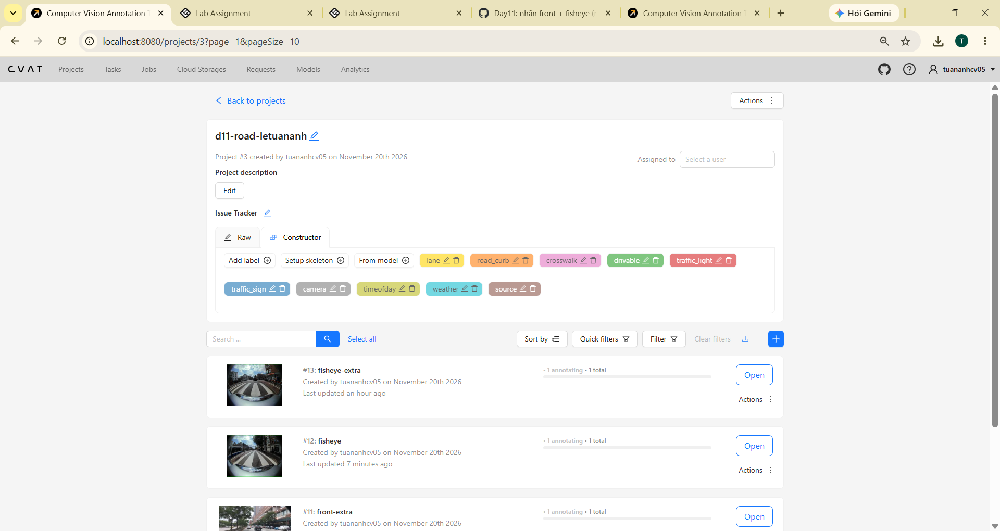
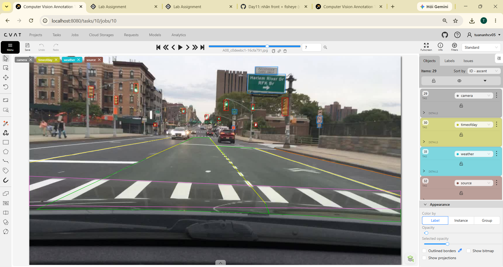
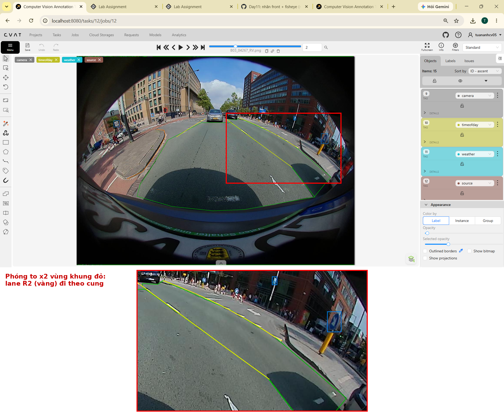
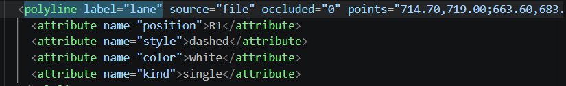

# Báo cáo cá nhân — Ngày 11
Họ tên: Lê Tuấn Anh              Mã học viên: 2A202604064  
Phiên bản CVAT (Help → About): **[TỰ ĐIỀN: mở CVAT → dấu ? → About]**  
Guideline: Road v1.0    Lần nộp (`revision` trong manifest): 2  
Thời điểm export (ngày giờ trên CVAT): 21/11/2026, 12:09 (front, fisheye — revision 2; revision 1 lúc 11:19–11:20, lưu ở `r1/`), giờ Việt Nam    Số lần nộp lại sau Rework: 1  

## 1. Kiểm project
| Mục | Đúng như guideline Road v1.0? | Ghi chú |
| --- | --- | --- |
| 6 label, đúng kiểu | Có | lane, road_curb (polyline); crosswalk, drivable (polygon); traffic_light, traffic_sign (rectangle). Nạp bằng tab Raw từ `configs/road_v1_labels.json` |
| Thuộc tính và giá trị | Có | Đúng tên và giá trị; `edge_zone` là checkbox; mọi thuộc tính `mutable = false` |
| 4 tag ảnh | Có | camera, timeofday, weather, source; mỗi tag có 1 thuộc tính select `value` |

Cách kết thúc polyline trên bản CVAT này: bấm phím **N** (hoặc bấm lại nút Polyline) sau điểm cuối cùng.  
Cách đặt tag ảnh trên bản CVAT này: chế độ **Tag annotation**, bấm phím tắt 1–4 (camera, timeofday, weather, source), mỗi phím một lần; hoặc nút **Tag** ở thanh công cụ trái trong chế độ Standard. Sau đó sang Standard, mở Details của từng tag để chọn `value`, vì CVAT tự điền giá trị đầu danh sách.

## 2. Số lượng đã gán
| Task | Ảnh | lane | road_curb | crosswalk | drivable | traffic_light | traffic_sign |
| --- | ---: | ---: | ---: | ---: | ---: | ---: | ---: |
| front | 12 | 29 | 9 | 3 | 25 | 30 | 35 |
| front-extra (đã làm 4 / 4) | 4 | 11 | 0 | 2 | 7 | 11 | 19 |
| fisheye | 8 | 8 | 11 | 7 | 9 | 6 | 5 |
| fisheye-extra (đã làm 4 / 4) | 4 | 1 | 4 | 4 | 4 | 0 | 1 |

Mọi ảnh có đủ 4 tag. CVAT export riêng từng task, nên front + front-extra được gộp thành `letuananh-front.zip` (16 ảnh) và fisheye + fisheye-extra thành `letuananh-fisheye.zip` (12 ảnh). Kiểm sau khi gộp: nhãn từng ảnh khớp 100 % với file export gốc.

## 3. Bảng ca khó
| Ảnh | Nhãn | Phân vân giữa | Đã chọn | Lý do |
| --- | --- | --- | --- | --- |
| A03 | tag timeofday | day / dusk | dusk | Ánh sáng yếu, trời xám tối dần; chưa phải night vì vẫn thấy rõ cảnh không cần đèn |
| A04, A11 | lane L1 (vàng đôi) | 2 polyline (mỗi nét một đường) / 1 polyline | 1 polyline giữa hai nét, `kind = double` | Guideline: một vạch là một polyline; vẽ 2 đường sẽ thành 2 polyline cùng position L1 (lint QC1-05) |
| A04 | lane R2 (2 nét trắng song song, dải đệm làn xe đạp) | `kind = single` / `double` | single | Hai nét là mép của dải đệm làn xe đạp, không phải một vạch kép phân làn |
| A05 | lane L1/R1 | vẽ theo mép xe đỗ / không vẽ | không vẽ; vẽ `road_curb` mép vỉa phải | Đường không có vạch sơn; guideline cấm vẽ vạch không có. Chờ coach xác nhận QC1-02 |
| A07 | mép trái sát dải bê tông | lane L1 / road_curb | road_curb | Không thấy vệt sơn liên tục trên ảnh mưa; mép là dải phân cách bê tông. Chờ coach xác nhận QC1-02 |
| A06, A08, A12 | đèn đi bộ (`type = pedestrian`) | màu của biểu tượng (trắng, cam) / ý nghĩa tín hiệu | theo ý nghĩa: người trắng đang sáng → `green`, bàn tay cam đang sáng → `red`, không sáng → `off` | Danh sách `color` không có trắng hay cam; chọn theo ý nghĩa tín hiệu (cho đi / cấm đi) để thống nhất giữa các ảnh. Quy ước này áp dụng khi sửa A08 theo phiếu QC |
| A08 | tấm "PASSENGER CARS ONLY" trên biển chỉ hướng | supplementary / prohibitory | supplementary | Là tấm nhỏ đi kèm biển chính, giới hạn đối tượng áp dụng |
| A06, A09 | lane R1 | vẽ / không vẽ | không vẽ | A06 bên phải là hàng cột đường sắt trên cao; A09 mép phải là vỉa sơn (gán `road_curb`). Chờ coach xác nhận QC1-02 |
| B05–B08, B10, B12 | lane ở camera hai bên | L1/R1 theo hướng nhìn / other | other | Guideline mục 4: fisheye_left/right luôn dùng `position = other` |

## 4. Phiếu QC 1 nhận được
Bạn kiểm lô của tôi: Lê Trần Phi Hùng (`letranphihung`)  Quyết định nhận được: **Rework** (0 lỗi nặng; 12 lỗi chính / 77 nhãn = 15,58 % > 5 %; mẫu A01, A05, A08, B02, B03, B08)  
| Mã lỗi | Số lỗi | Đồng ý? | Đã sửa? |
| --- | ---: | --- | --- |
| QC1-06 | 2 | 1/2. **Không đồng ý** #1 (A01 lane#5 L2 `kind=double`): phóng to trên ảnh gốc chỉ thấy **một** nét trắng liền, giữ `single`. **Đồng ý** #10 (B03 lane#5 R2 là vệt đứt): đổi `style=dashed` | #1 giữ nguyên (không đồng ý); #10 **đã sửa** (`style=dashed`) |
| QC1-07 | 2 | Đồng ý #2 (A08 crosswalk#2: cắt biên dưới theo mép capô) và #8 (B03 drivable#0: không lõm quanh xe phía trước, tô theo "đi được nếu đường trống") | #8 **đã sửa**; #2 **chưa sửa** (đã chỉnh biên dưới của drivable A08, crosswalk giữ nguyên) |
| QC1-08 | 5 | Đồng ý cả 5: A08 thiếu 4 cụm đèn (tâm ≈ 433,237 đèn đi bộ bàn tay cam; ≈ 780,236 đèn đi bộ người trắng; ≈ 611,208 và ≈ 652,216 đèn xe xanh); B02 thiếu đèn đỏ mép trái (≈ 54,380, bật `edge_zone`) | **Đã sửa 5/5**: A08 thêm 2 đèn đi bộ (red, green) và 2 đèn xe (green); B02 thêm đèn đỏ có `edge_zone` |
| QC1-04 | 1 | **Đồng ý một phần** #9 (B03 lane#4 R1): vật trắng ở ≈ (925,590) không phải vạch sơn (vệt giấy/rác lệch khỏi đường vạch), nhưng trong bóng xe ở ≈ (1105,565) có một vệt trắng nằm trên phần kéo dài theo cung của R1 | Chưa sửa: vệt trong bóng xe không chắc là vạch, giữ điểm đầu cũ |
| QC1-10 | 1 | Đồng ý #11 (B03 traffic_sign#10): thu box sát biển tròn, bỏ nền và trụ vàng | **Đã sửa** (thu hộp từ 42×57 px còn 32×47 px) |
| QC1-11 | 1 | Đồng ý #12 (B08 lane#2): đặt lại điểm vào tâm vệt trắng rộng, giữ `position=other` | **Đã sửa** |
| Ca mơ hồ A05 (QC1-02) | — | Đồng ý chờ coach xác nhận miễn | — |

Nộp lại revision 2 (21/11/2026, 12:09): đã sửa 9/12 lỗi được ghi (#3–#8, #10, #11, #12); 1 lỗi không đồng ý (#1); 2 lỗi chưa sửa (#2 crosswalk A08 đồng ý nhưng chưa kịp sửa; #9 R1 B03 đồng ý một phần, giữ nguyên), ghi rõ ở bảng trên. Lint revision 2: 28 ảnh, chỉ còn 5 cảnh báo QC1-02 chờ coach xác nhận. Bản revision 1 giữ ở `r1/` (manifest `letuananh-manifest-r1.json`).

Đã sửa trước khi nộp lần đầu (tự kiểm bằng `road_check lint`, revision 1):
- B06, B07: lane chưa đổi `position = other` (QC1-03) → đã sửa.
- A10: lane R1 vẽ từ xa về gần (QC1-04) → đã vẽ lại từ gần ra xa.

## 5. Kiểm file export
| File | Mở lại được? | Số shape ảnh 1 (job / file) | Số shape ảnh 2 (job / file) | Tag camera có trong XML? |
| --- | --- | --- | --- | --- |
| letuananh-front.zip | Có (`road_check lint` đọc 16 ảnh) | A08: 25 / 25 (job hiện Items 29 = 25 shape + 4 tag, xem ảnh 6.2) | A01: — / 9 | Có (16/16 ảnh, `camera = front`) |
| letuananh-fisheye.zip | Có (`road_check lint` đọc 12 ảnh) | B03: 11 / 11 (job hiện Items 15 = 11 shape + 4 tag, xem ảnh 6.3) | B02: — / 7 | Có (12/12 ảnh, khớp đuôi FV/RV/MVL/MVR) |

Lint lần cuối (revision 2): 28 ảnh, 5 cảnh báo, tất cả là QC1-02 ở A05 (L1, R1), A06 (R1), A07 (L1), A09 (R1), là các ảnh không thấy vạch, chờ coach xác nhận. Manifest: `contains_images = false` cho cả hai file.  
*(Số shape trong job lấy từ mục Items của bảng Objects trên CVAT, trừ 4 tag; khớp với số shape trong file export.)*

## 6. Ảnh chụp màn hình
1. Tab Labels của project.

   

2. Một ảnh camera trước đã gán đủ (làn, vùng lái, đèn/biển): A08.

   

3. Một ảnh fisheye đã gán, phóng to đoạn polyline cong: B03.

   

4. Một đoạn XML có `<polyline label="lane">` (mở `annotations.xml` trong `letuananh-front.zip`).

   

## 7. Tự đánh giá
Lỗi bạn mắc nhiều nhất hôm nay (theo mã QC1-xx), và cách tránh ở Ngày 20:  
**QC1-03 (position)**: ở ảnh camera hai bên B06, B07, mỗi ảnh còn một lane mang giá trị mặc định `L1` thay vì `other`, vì CVAT tự điền `L1` cho polyline mới và tôi quên mở Details sửa. Thứ hai là **QC1-04**: lane R1 ở A10 vẽ từ xa về gần. Cách tránh ở Ngày 20: vẽ xong mỗi polyline thì mở Details sửa thuộc tính ngay; với task fisheye hai bên, kiểm lại toàn bộ lane trước khi Finish; và chạy `road_check lint` sau mỗi lần export, trước khi nộp.

Nhãn của bạn đi vào model ở đâu? Chọn một lỗi đã sửa và nói nó làm model học sai thế nào:  
Polyline `lane` kèm `position` là đích học của model nhận diện làn (dạng row-anchor: tọa độ x của vạch L1/R1 tại từng hàng ảnh). Đầu ra này được hệ thống giữ làn (LKA) dùng để biết hai mép làn xe đang đi. Lỗi B06/B07 gán `L1` cho vạch nhìn từ camera hông dạy model rằng một vạch ở cạnh xe, nhìn nghiêng, là mép trái của làn đang đi. Nếu lặp lại nhiều, model sẽ nhầm vạch làn bên cạnh thành mép làn của mình, khiến LKA ước lượng sai vị trí xe trong làn và có thể lái lệch. Tương tự, polyline vẽ ngược chiều (A10) làm sai thứ tự điểm, khiến các script tính đích theo hàng hiểu điểm đầu là phía xa xe.

## 8. (Tùy chọn, buffer) Từ polyline đến đích row-anchor
Ảnh A01, vạch trắng đứt sát bên phải làn mình (R1). Số liệu từ `road_lab.rowanchor`; bạn kia gán vạch này là L2 (lane #9).

| y | 720 | 680 | 640 | 600 | 560 |
| --- | ---: | ---: | ---: | ---: | ---: |
| x của chúng tôi | không có làn | 658,3 | 600,5 | 542,6 | 484,8 |
| x của bạn kia | 714,4 | 657,1 | 599,7 | 542,3 | 484,3 |

Trả lời 3 câu:

1. Điểm xa nhất của polyline R1 của tôi ở y ≈ 507. Dừng sớm 40 px thì điểm xa nhất ở y ≈ 547, vẫn cao hơn hàng 560, nên **không hàng nào** trong 5 hàng đổi thành "không có làn". Chỉ khi dừng sớm hơn khoảng 53 px thì hàng 560 mới mất. Ở đầu gần, điểm đầu của tôi ở y = 719 nên hàng 720 đã là "không có làn": thiếu 1 px ở sát xe cũng làm mất hàng quan trọng nhất.
2. Hàng 720: tôi không có giá trị, bạn kia có x = 714,4 (không so được, lệch do điểm đầu của tôi thiếu 1 px). Hàng 560: lệch 0,5 px. Lệch ở **hàng gần xe (720)** ảnh hưởng LKA nhiều hơn, vì hàng gần nhất cho biết vị trí ngang của xe so với vạch ngay lúc này. Một pixel ở gần xe tương ứng khoảng cách thật nhỏ, nhưng mất hẳn giá trị ở hàng đó thì model không có đích cho vùng quan trọng nhất.
3. Công thức nội suy x theo y **không đổi** nếu chỉ nội suy giữa hai điểm kẹp hàng y. Nhưng những gì dựa vào thứ tự điểm sẽ gặp khó: `road_check` kiểm "điểm đầu phải gần xe" (báo QC1-04) và kiểm hai đầu polyline so với GT; script nào lấy điểm đầu làm điểm sát xe sẽ lấy nhầm điểm xa nhất.
